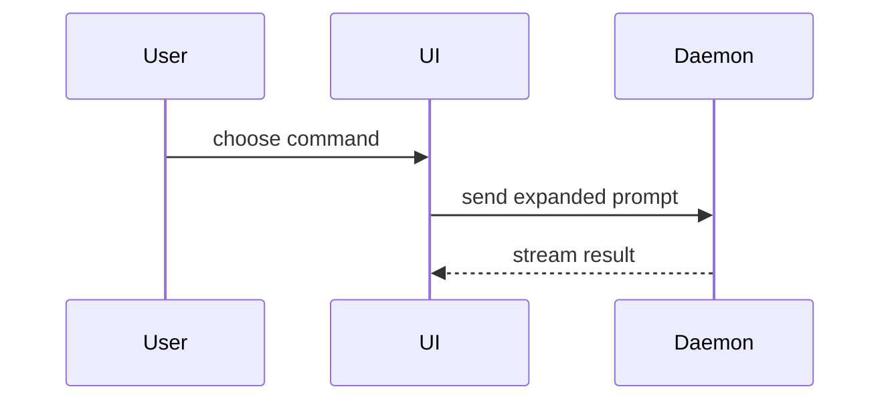

> Fork of humanlayer/skills `plugins/show-me/skills/show-me` with a cross-platform artifact
> opener (native Windows, WSL, Linux, macOS, devcontainers) in place of the macOS-only `open`
> command. Upstream commit, patches, and audit findings: `vendor/show-me/` in
> CtrlCarlitos/skills. Drop-in: same name, same description. Manual-only invocation
> (`disable-model-invocation`) is honored by Claude Code and Codex; OpenCode currently ignores
> it ([anomalyco/opencode#11972](https://github.com/anomalyco/opencode/issues/11972)) and
> Antigravity is unverified — tracked in #12. An explicit "only act when asked" instruction
> below is a content-level mitigation for harnesses that ignore the flag; it doesn't stop the
> skill from being loaded into context there, and isn't a hard guarantee the way a harness-level
> block is — not fixable from this fork either way.

**Only act when the user explicitly asked for this** — via `/show-me`, a direct "show me ..." request, or an unambiguous instruction to use this skill. If you are reading this file but were not explicitly asked, do not produce a diagram, pseudocode block, file tree, diff, or HTML explainer — continue the conversation normally instead. This holds regardless of whether your current harness enforces manual-only invocation at the tool level (some do not); treat this instruction as authoritative either way.

Help the user understand the current topic of conversation visually. Skip the preamble and keep prose brief. Pick the smallest view that makes the key point clear.

- Show logic or an algorithm as pseudocode:

```text
on(save)
  if content is unchanged
    return cached result
  write new content
  return fresh result
```

- Show runtime control flow as a call tree:

```text
submitForm
  createSession
    persistPrompt
    launchAgent
  navigateToSession
```

- Show UI structure as a component tree, including state and module boundaries that matter:

```tsx
<SessionPage> (apps/example/src/routes/session.tsx)
  useSessionEvents()
  <SessionToolbar>
    <RunSkillButton> (packages/ui)
```

- Show file responsibility or a broad refactor as a shallow file tree:

```text
src/
├── commands/       # parses user actions
├── sessions/       # owns session state
└── transport/      # sends API requests
```

- Show component interaction, control flow, or data flow with Mermaid:



- Use `diff` when the point is what changes and the surrounding shape already exists. Match the diff shape to the topic.

For a component change:

```diff
 <SessionPage>
   useSessionEvents()
   <SessionToolbar>
+    <RunSkillButton />
   <SessionTimeline>
+    <SkillResultCard />
```

For a file-layout change:

```diff
 src/
 ├── commands/
+│   └── show-me.ts       # expands the slash command
 ├── sessions/
-└── transport.ts
+└── transport/
+    ├── client.ts
+    └── stream.ts
```

For a call-tree or call-stack change:

```diff
 submitForm
   createSession
     persistPrompt
+    expandSkillMention
     launchAgent
-  navigateToSession
+  navigateToSession
+    subscribeToEvents
```

For a state or control-flow change:

```diff
 on(save)
-  write content
+  if content is unchanged
+    return cached result
+  write new content
+  invalidate cache
```

- Show the whole block when most of it is new, when omitted context would hide ownership or order, or when the user needs a copyable target shape:

```ts
function expandSkill(command: string): string {
  const skillName = command.slice(1)
  return `use the ${skillName} skill`
}
```

- For a visual UI, layout, state comparison, or concept too dense for Mermaid, write one focused HTML file — a diagram, an infographic, or a short slide deck, whichever fits the point. Match the product's colors, type, spacing, and components; use real labels and data; support desktop and mobile. Write it somewhere writable outside this skill's own installed directory (which may be read-only), then open it for the user:

```
Bash(python3 <path-to-this-skill>/scripts/open_artifact.py path/to/show-me-{description}.html)
```

This works the same way on native Windows, WSL, Linux, macOS, and in devcontainers: it always prints the artifact's real path, and only also attempts to launch a viewer when one is actually available on the current machine — detected, not assumed. A missing opener never loses the artifact, hangs, or gets retried; the file and its path are the result either way.

### guidance

Place each visual next to the short text it supports. Keep only the calls, files, props, states, and boundaries needed to answer the user's current question or the options to resolve the current discussion point.

You may use one of these, you may use several, it is unlikely you will use all of them. Use your judgement and don't overwhelm the user.
